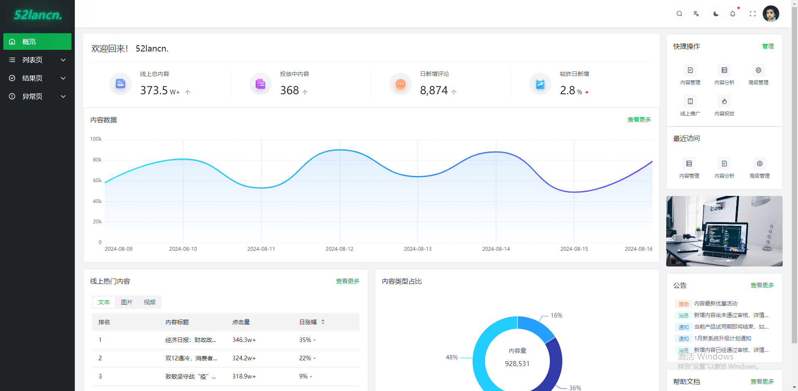

# vue-admin

仅个人学习实践项目，请勿用于生产。

基于 [Arco Design Vue](https://arco.design/)  组件库的开箱即用的中后台前端解决方案。




## 使用

```shell
$ git clone https://github.com/52lancn/vue-admin.git
$ cd vue-admin
$ pnpm i
$ pnpm run dev
```

## GitHub Pages 预览

推送到 `main` 后，GitHub Actions 会自动构建并发布到 [https://52lancn.github.io/vue-admin/](https://52lancn.github.io/vue-admin/)。也可以在 Actions 页面手动运行 `Deploy to GitHub Pages` 工作流。

首次发布前，请在仓库的 **Settings > Pages > Build and deployment** 中将 **Source** 设置为 **GitHub Actions**。
